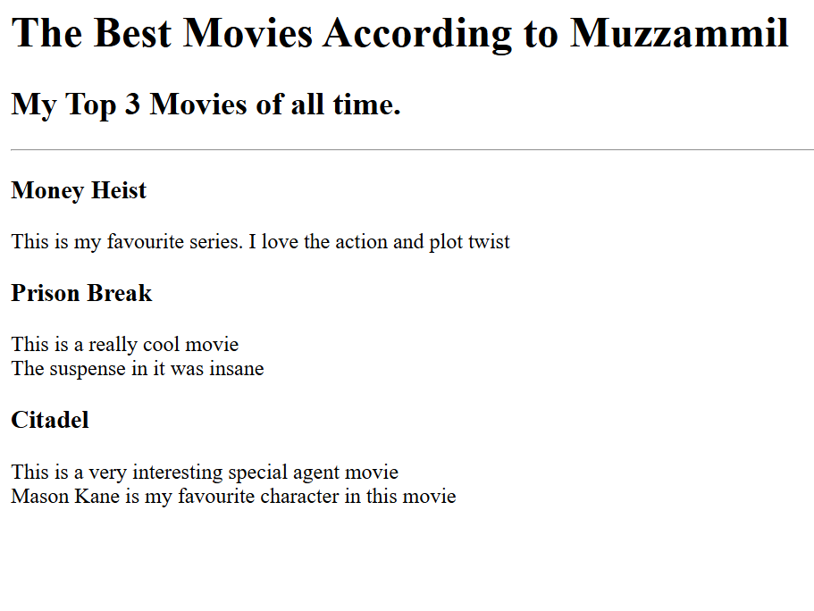

# HTML Portfolio

One of my first web projects: a multi-page portfolio written in plain, semantic HTML while learning web development. It links to two small pages I built along the way, a **movie ranking** page and a **birthday invitation**.

**Live:** https://muzzammil45.github.io/html-portfolio/

| Movie ranking | Birthday invite |
|---|---|
|  |  |

## What it practises

- Document structure: headings, paragraphs, lists, horizontal rules
- Relative links between pages and folders
- Images with alt text, external links (maps)
- Organising a small site: `index.html` at the root, sub-pages in `public/`, images in `assets/`

## Structure

```
index.html            portfolio home
public/
  movie-ranking.html  my top 3 shows
  birthday-invite.html
  about.html
  contact.html
assets/images/        page previews
```

Built as part of a web development course. For my current work, see my [GitHub profile](https://github.com/Muzzammil45).
